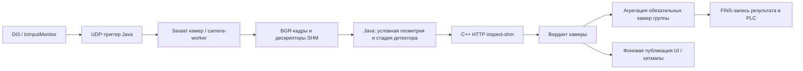

# Архитектура текущей ветки

**Код: `cpp-detector` / `bfd9b54a`, проверено 2026-10-27.** [Контекст](PROJECT_CONTEXT.md).

## Компоненты и границы

| Компонент | Назначение и состояние |
|---|---|
| `orchestrator-java` | Управление циклами, захватом, HTTP/RPC, эталонами, группами камер, UI и FINS. Java остаётся частью критического пути. |
| `camera-worker` | Нативный C-код захвата; CMake собирает `camera_worker`. Реальные транспорт, SDK и триггерный режим определяются запуском. |
| `cppAnalisSurface` | Текущий C++-детектор поверхности: эталон, ROI, X/Y-выравнивание, сравнение, score, опциональная проверка линии шва, экспорт карт. |
| `front-end` | React/TypeScript UI, эталоны и настройки. Не формирует аппаратный выход отбраковки самостоятельно. |
| `IoInputMonitor` | DI-события и UDP, импульс DO5 для камер в Line0-режиме. |
| `LightServer.v3` | Управление освещением. |
| `analisSurface` | Старый Python backend. Выбирается отдельно; нормы/FP из него не участвуют в C++-инспекции. |
| `java-positioning-service` | Старый отдельный positioner, в шаблоне `java_positioning.enabled: false`. |
| `java-geometry-service` | Отдельный геометрический сервис с условным запуском/использованием. Может быть отключён для камеры, пропущен без нужного ROI или отсутствовать в пуле. |

Каталоги старых сервисов и их сборка всё ещё есть. Корневой `rebuild-and-run.ps1`, в частности, собирает Java geometry и Java positioning. Это не доказывает выполнение их инспекции.

## Путь кадра и результата

Геометрическая стадия в Java может передать `SKIPPED`; это не измерение геометрии. `DefaultInspectionDecisionAggregator` объединяет результат поверхности с геометрическим результатом. Текущий дефект в обработке неизвестного статуса описан в [known_issues](known_issues.md).

В шаблоне `inspection_bucket.mode: ten_cameras` используются группы 0–4 и 5–9. Время отдельной камеры, готовность всех обязательных камер группы и готовность всех десяти ответов — разные величины. Локальный benchmark измерял последнюю из десяти камер; реальный итог зависит от включённых камер и режима агрегации.

## Триггер и бюджет

В [шаблоне аппаратного ввода](../config.exemple/blocks/52-io-input.yaml): DI1 — работа, DI2 — направление, DI3 — съёмка, DI4 — shutdown. DO5 запускает камеры; вердикт передаётся по FINS.

В шаблоне IoInputMonitor есть `pulse_delay_ms: 250` перед импульсом съёмки. В Java `capture_delay_ms: 0` не отменяет эту аппаратную задержку. Для предела 500 мс нужно проверить фактические оба конфига и точку начала отсчёта. Эти значения не подтверждены как текущие настройки станка.

`inspection_bucket.timeout_ms: 3500` и большие RPC-тайм-ауты в шаблоне не являются доказательством соблюдения срока 500 мс. Это параметры ожидания/отказа, не измеренная длительность штатного цикла.

## Параллельность и UI

- Шаблон: `camera_parallelism: 10`, разнесение триггера камер 0 мс, `python_parallelism: 10`, `python_request_parallelism: 10`, `python_server_pool_size: 1`.
- Имена `python_*` исторические: при backend=cpp стадия вызывает `CppAnalisSurfaceHttpSupervisor`.
- C++ отдельно ограничивает число одновременных инспекций через `Service::Slot`; HTTP-потоки и вычислительные слоты — разные ограничения.
- При `defer_heatmap: true` основной вызов не запрашивает карту. Sidecar может сделать дополнительную инспекцию с экспортом карты на том же сервисе. Слово «фон» не означает отсутствие конкуренции с новым вердиктом.

## Эталон и ROI

В frontend [ReferenceController](../front-end/src/components/ReferenceSetup/ReferenceController.ts) есть `handleRefreshFramesKeepingRoi`: проверяет ROI всех камер группы, получает свежие кадры и отправляет новый эталон с сохранёнными ROI. Полная замена через другой обработчик сбрасывает редактируемые ROI/FP-зоны. Надпись в интерфейсе о линии перспективы не доказывает поддержку перспективного выравнивания C++-детектором.

Проверять сохранение ROI по полной цепочке frontend → bundle → Java → C++, особенно после смены размеров изображения или профиля. Новый сырой upload эталона и действие UI «обновить кадры, сохранив ROI» не следует считать взаимозаменяемыми.

## Исходники для перепроверки

- [AsyncInspectionCycleRunner](../orchestrator-java/src/main/java/com/example/iml/orchestrator/integration/pipeline/session/AsyncInspectionCycleRunner.java).
- [InspectPythonExecutor](../orchestrator-java/src/main/java/com/example/iml/orchestrator/integration/pipeline/stages/InspectPythonExecutor.java), [InspectGeometryExecutor](../orchestrator-java/src/main/java/com/example/iml/orchestrator/integration/pipeline/stages/InspectGeometryExecutor.java).
- [DefaultInspectionDecisionAggregator](../orchestrator-java/src/main/java/com/example/iml/orchestrator/integration/pipeline/decision/DefaultInspectionDecisionAggregator.java).
- [BucketInspectionAggregator](../orchestrator-java/src/main/java/com/example/iml/orchestrator/integration/pipeline/bucket/BucketInspectionAggregator.java).
- [UiArtifactsSidecar](../orchestrator-java/src/main/java/com/example/iml/orchestrator/integration/ui/UiArtifactsSidecar.java).
- [Конфигурация ядра](../config.exemple/blocks/01-core.yaml), [детекторы](../config.exemple/blocks/20-detectors.yaml), [камеры](../config.exemple/blocks/10-cameras.yaml).
