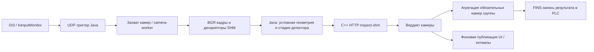

# 2026-11-13 — Merge compensation и контур этикетки

Текущий merge 79483801/bd9f704e разрешён. Сохранены ROI-aware обработка края,
кэш дообучения и входящие inspection slots. Из CppDetector b0535b01 добавлены
контур этикетки, перенос по сдвигу, запас 1 px и переключатель камеры.
Маска инспекции независима от изменяемого кэша; привязка эталона требует
явного повторного подтверждения после замены изображения. Это сохраняет
исправления ветки и позволяет исключать открывающийся фон ведра.
Чистый CTest 16/16, frontend 125/125, TypeScript/Vite и Java build + 8 тестов,
HTTP 9 сценариев прошли. Аппаратные камеры/PLC/Linux/длительный поток не
проверялись; первый инкрементальный сбой дообучения описан в отчёте.
Runtime не заменялся. Merge подготовлен в индексе, commit/push остаются
пользователю. Исторические записи ниже сохранены как история.
[Реализация, контракт, проверки и ограничения](analis-surface/2026-11-13-label-contour-transfer.md).

# 2026-11-09 — Кэш зон сохранён при robust learning

В исходниках поверх e5ae6f93 matcher получает Prepared текущей инспекции,
включая её ROI/exclusions и геометрию углов. Повторные prepared(scale) без зон
удалены; primaryOverride компенсации сохранён. При неизменных зонах cache
перестраивался 8/8, теперь 0/8. Новая регрессия воспроизводит сбой старого core.
Release/CTest 14/14, 300 архивных сравнений без изменений, 720 конкурентных
вызовов с нормами без отличий и три HTTP-прогона прошли. Контрольный C++ пакет
10 камер с зонами/нормами: медиана 50% 148.45 → 61.99 мс, 100% 144.49 → 86.50.
Это самосравнение без HTTP/захвата/PLC, не полный поток станка.
Ореол на границе зон остаётся отдельным риском; этот код не менялся.
Рабочий runtime/конфиги не обновлялись. Прежние заметки проверки сохранены.
[Реализация, регрессия, время и ограничения](analis-surface/2026-11-09-learning-exclusion-cache-fix.md).

# 2026-11-09 — Проверка текущего merge e5ae6f93

Merge уже закоммичен и совпадает с origin/compensation. Без зон 300 пар
сравнений архивных кадров до/после дали одинаковые score/позицию/вердикт;
60 самосравнений нулевые. В 1440 конкурентных инспекциях с фиксированными ROI
и разными зонами/масштабами результаты совпали с baseline. HTTP/SHM 600/600
корректны; отказ записи/reset и три запуска сервиса проверены отдельно.
Свежие CTest детектора 14/14 и camera-worker/JNI без SDK, native tests 2/2.

Выявлены два риска новых зон: robust learning вызывает prepared(scale) без
exclusions и пересоздаёт кэш на каждом кадре; зоны+нормы в контрольном C++
замере увеличили время пакета десяти камер при 50% до ~149 мс против 59–68 мс
с зонами без норм. Дефект целиком внутри зоны, касающийся её границы, может
дать внешний ореол и score1/ложный брак; native-выход дефекта за зону равен 0.
В локальном checkout нет config/ips.yaml: настоящий YAML loader отклоняет
config/config.yaml до его создания. Адреса устройств не подбирались.
Код/настройки/runtime не менялись. Это локальные тесты, без камер/MVS/PLC,
Linux, физической калибровки и длительного непрерывного прогона.
[Метод, результаты, два риска и условия запуска](audits/2026-11-09-postmerge-stability.md).

# 2026-11-09 — Совмещены compensation и origin/boobs+pasha

Разрешены восемь конфликтов merge 9c2d7959/a120fe68. В CMake сохранены тесты
настроек/ROI и исключений; AlignmentPrepared хранит nativeRoiMask вместе с
exclusions. Исправления белой полосы и атомарного set/reset сохранены вместе
с зонами, новым UI и входящим config/. Входящий диапазон мм 0..15 сохранён.
Обе истории knowledge объединены; старые committed conflict markers в incoming
analis-surface/overview удалены с сохранением обоих текстов.
Release/CTest 14/14, 288 совместных C++ инспекций и два HTTP-прогона прошли.
Frontend: TypeScript, Vite build, 109/109 Vitest; Java: 427 passed/13 skipped,
один класс повторён после добавления npm в PATH. Runtime не развёртывался;
Linux, камеры/MVS/PLC и camera-worker сборка не проверялись. Merge подготовлен
в индексе, commit/push остаются пользователю. Нижние записи сохранены как история.
[Решение, сохранность и проверки](deploy-ops/2026-11-09-merge-compensation-boobs-pasha.md).

# 2026-11-09 — Проверяемое сохранение и сброс настроек

Исправлен пункт 6 последнего аудита: SettingsStore записывает полный временный
файл рядом с основным, проверяет write/flush/close и замену, затем фиксирует
карту профилей. При ошибке set/reset прежние файл и значения в памяти остаются,
успешный ответ не выдаётся. Прямой fallback с обнулением JSON удалён, временные
файлы разных процессов разделены. DELETE также возвращает JSON io_error через
общий обработчик. Windows-конфликты sharing/access повторяются до 75 мс.
Release/CTest 13/13; новый тест 70 проверок, HTTP 17 проверок/15 запросов и
три запуска процесса подтверждают сохранение, отказ, восстановление и reset.
Предыдущий код не проходит новую регрессию. Рабочий runtime/конфиг не обновлялся;
Linux и отключение питания не проверялись. Другие семь пунктов аудита открыты.
[Реализация, проверки и ограничения](analis-surface/2026-11-09-settings-persistence-fix.md).

# 2026-11-06 — Исправление смешанной кромки при допустимом сдвиге

При компенсации ROI исключается примесь фона в пограничных образцах;
эталон и кадр получают общие восстановленные веса. При 50/80% чувствительности
на архивных и независимых моделях ложные отказы устранены; повреждения края
8/16 px сохранены. Цена — ограниченная наблюдаемость самой тонкой кромки
порядка 1–2 native px. На 95% отдельные отказы остаются; включённый внутрь ROI
неподвижный фон автоматически не исключается. Позиционирование/мм/score/
ослабление прежние. Чувствительность 0% намеренно отключает весь reject —
пользователь подтвердил, это не ошибка. Runtime не обновлялся.
[Реализация, проверки, время и ограничения](analis-surface/2026-11-06-mixed-boundary-fix.md).

# 2026-11-06 — Компенсация ROI с учётом опоры пикселей, compensation

База 663ee885. Native phase256/ECC512 и проверка допуска прежние. Для заданного
ROI маска проецируется в текущий кадр; яркость внутри маски и веса компенсируются
согласованно, затем resize/Gaussian5 и деление на веса. Эталон использует ту же
подготовку; его отдельный refGray для измерителя сохранён. Prepared кэширует
refComparisonGray/roiWeights и разделяет nativeRoiMask между масштабами одного ROI.
Robust learning получает тот же основной эталон. Min/max-конверт не использует
внешние пиксели ROI. Mask/area/score/мм прежние; без ROI старый full-frame путь.
[Тесты, затраты и ограничения](analis-surface/2026-11-06-label-roi-compensation.md).
# Вычислительные слоты с явной affinity — 2026-11-11

В исходниках InspectionSlots::Lease связывает слот с одним физическим CPU,
восстанавливает маску и освобождает слот при успехе/исключении. CLI/env,
проверка маски/SMT, health/performance с CPU; config workers3/CPU3–5, ECC прежний.
Бинарник подготовлен, действующий сервис ещё старый.
[Реализация, проверки и границы разделения Java/IO](performance/2026-11-11-inspection-cpu-slots.md).

# Фактическое размещение вычислений на станке — снимок до исправления, 2026-11-11

Для PID Java36205/C++36256 подтверждено: workers4 и общая маска2-5,8-11
не обеспечивают параллельное исполнение при isolcpus=domain; все потоки
в проверенном окне находились наCPU2. C++ Service::Slot — счётчик конкурентных
запросов без CPU affinity. Эта конфигурация станка требует явного размещения
вычислителей; на момент снимка код/запуск ещё не исправлялись.
[Аудит, локальное воспроизведение и границы](performance/2026-11-11-code-latency-root-cause.md).

# Статистика frontend — 2026-11-09

Накопительные счётчики получают производственные WS-результаты независимо от архива
кадров и хранят только числа, ID и битовые признаки. Ручной сброс отделён от сброса
инспекции; новое поколение capture/preview начинает отсчёт заново. Постоянного хранения
нет. [Реализация и ограничения](ui/inspection-statistics.md).

# Конфигурация с 2026-11-09 — boobs+pasha

Актуальные общие настройки находятся в отслеживаемой `config/`, исходник —
рабочие файлы femboy36 `~/Документы/core-dev/config/` (832e4fc0).
`config.exemple/` удалена. Единственный локальный конфиг IP — игнорируемый
`config/ips.yaml`; в общих YAML ссылки `${ip:ключ}`. Камеры настраиваются
только YAML, внутренний JSON для JNI генерируется Java. Bayer RG 12 Packed
сохранён и явно поддержан C/MVS. Ниже сохранены исторические сведения,
в том числе о прежнем config.json; они не описывают новый способ загрузки.
[Подробности](../config/README.md), [решение](decisions.md).

# Зоны и компенсация исходника — 2026-11-06

В объединённой версии ранний пропуск полностью исключённой поверхности
предшествует native phase/ECC. Для непустой области перенос применяется к
полному исходнику до подготовки изображения сравнения (gray/resize/blur);
маски ROI/exclusions затем ограничивают сравнение, как прежде. Измерение
позиционирования сохраняет отдельную native-gray подготовку.
[Разрешение конфликтов и регрессии](deploy-ops/2026-11-06-merge-exclusions-compensation.md).

# Маски и native positioning объединены — 2026-11-06

Reference::prepared(scale, exclusions) строит карты через общую предобработку,
а native AlignmentPrepared — с той же ROI и списком зон. Exclusions вычитаются
из comparison/corner masks, coarse Hann и ECC fineMask. Shared alignment
переиспользуется между масштабами только для одинакового списка; другой
конкурентный вариант не изменяет уже выданные Prepared. API зон не менялся.
[Решение merge и проверки](deploy-ops/2026-11-06-merge-exclusions-ecc.md).

# Маски исключений — 2026-11-06, boobs+pasha

SettingsStore сохраняет `exclusions` в профиле; Java detector-settings proxy уже
передаёт их. Reference::prepared(scale, exclusions) кэширует неизменяемый вариант
маски для каждой инспекции, без общего изменяемого поля. Зоны ограничивают
статистику/diff/score, позиционирование, heatmap и проверку сечений шва.
InspectionDecision несёт `inspectionExclusions` в WS/архив; sidecar повторяет
heatmap с исходным списком зон. UI не менялся; новые API/поля доступны после
пересборки C++/Java runtime. [Архитектура, конкуренция и проверки](analis-surface/inspection-exclusions.md).

# 2026-11-06 — Порядок компенсации в ветке compensation

База c43e9d4d. `inspectFrame`: native-gray → phase256/ECC512 → проверка допуска →
перенос полного исходного кадра → gray/resize/Gaussian5 → ROI-сравнение.
Подготовка эталона, измеритель, confidence, score и настройки прежние.
При нулевом/неприменимом переносе warp пропускается. `prepare_ms` теперь
отражает native-подготовку, а `align_ms` включает также подготовку сравнения
после переноса; старые частичные таймеры напрямую не сопоставимы.
Это изменение исходников; установленный runtime не обновлялся.
[Реализация и проверки](analis-surface/2026-11-06-compensation-before-blur.md).

# 2026-11-05 — Задержка света и сброс норм объединены перед push

Сохранены локальный ee22b3eb (задержка света 2000 мс) и входящий c83d2b3c
(сброс норм при полном запуске и сверка миниатюр UI). Пять конфликтов
knowledge разрешены с сохранением обеих историй; код объединён Git.
Рабочий runtime в этой Git-задаче не обновлялся и нормы не очищались.
[Состав, проверки и границы](deploy-ops/2026-11-05-merge-delayed-flash-reset.md).

# Включение света с задержкой — 2026-11-05

DI2↑ ставит bank On через `light_servers.interval_flash.on_delay_ms`
(рабочее значение 2000 мс, default без ключа 0). DI2↓/допущенный ExposureEnd
и close отменяют ожидающий On; поколение окна защищает от старой задачи.
Резервирование света/яркости действует и во время задержки.
Для первой выборки HIGH применяется немедленный On: время её фронта неизвестно.
Для последующих наблюдаемых 0→1 действует задержка. В runtime
заменены только классы света поверх прежнего JAR; остальной merge отдельно
не развёрнут. Финальная сессия 13:30:13: шесть полных окон, запас On до
ExposureStart 219–360 мс; на срезе NO_REFERENCE, требуется активация эталона.
[Проверки и детали](deploy-ops/2026-11-05-delayed-flash.md).
# Совмещены lifecycle норм и события света — 2026-11-05

Вместе присутствуют bootstrap-сброс learned normals из 389c3f20 и ExposureEnd
из 1e0a973b. ChildProcessStartupService управляет нормами на полный запуск;
TriggerRuntimeBootstrapService подключает event-based interval flash.
Съёмка остаётся DI3-only; DI2 относится к окну света/fallback выключения.
ECC/сравнение и frontend не редактировались, исходники сверены с родителями.
Проверены Java и Windows native без SDK; Linux/MVS/оборудование не запускались.
[Проверки и состав](deploy-ops/2026-11-05-merge-norms-exposure-end.md).

# Сброс норм на bootstrap приложения — 2026-11-05

ChildProcessStartupService вызывает новый метод C++ HTTP-клиента для каждого
уникального baseUrl: DELETE accepted-cases и GET-подтверждение пустого
списка. Ошибка останавливает bootstrap. Client.start/restart и WS Stop/Start
этот метод не вызывают; нативное сохранение norm metadata/PNG остаётся для
восстановления C++ процесса. Сопоставление/score не менялись.
WS hello запускает в UI сверку с GET всех cases после hydration библиотеки.
Отсутствующие IDs и миниатюры убираются одним обновлением, новые во время
запроса сохраняются. Эталоны и контуры не очищаются.
[Подробности, проверки и ограничения](analis-surface/2026-11-05-learning-session-reset.md).

# Граница исходники/runtime после merge — 2026-11-05

Исходники объединяют ExposureEnd из 4b5e8efd и DI3-only/ECC512 из 37499f9e.
Wiring всех камер и проверка 30 окон сохранены. Работающий backend после
аппаратного замера не перезапускался: новое DI3-only/ECC поведение не
считается проверенным на станке. Ниже сохранены заметки обеих историй.
[Проверки слияния и состав](deploy-ops/2026-11-05-merge-exposure-end.md).

# Управление светом по ExposureEnd — 2026-11-05

Текущая локальная JNI подписывает все камеры на Line0/ExposureStart/ExposureEnd.
SDK callback → ограниченная native очередь → dispatcher → JNI NativeCameraEvents
→ ExposureEndFlashGate → последовательный executor банка света.
DI2↑ включает банк; последние ExposureEnd всех открытых камер выключают
его после 30 полных проверенных окон. DI2↓ сохраняется как fallback.
События старого окна, дубли и потери не могут дать допуск раннему Off.
[Архитектура, параметры и реальные проверки](deploy-ops/2026-11-05-exposure-end-flash.md).

# Срез исходников — 2026-11-05, fd442c97

Локальная ветка теперь указывает на fd442c97. По Git diff относительно 20909141
изменён только нативный camera-worker: добавлен журнал событий Line0RisingEdge/
ExposureStart и его тест. Java, C++-детектор, frontend и Git-шаблоны не изменились.
Сборка и развёртывание в этой задаче не выполнялись; сведения о работе сервиса ниже
относятся к прежним проверкам. [Переход и границы](deploy-ops/2026-11-05-head-fd442c97.md).

# Архитектура после отката — 2026-11-04

Исходники возвращены к `20909141`. Работает прежний trigger/capture путь
коммита, без последующих DI3-only и постоянного HardwareFrameReception.
Более поздние результаты не являются проверками этой версии.
[Откат, резервные копии и проверки](deploy-ops/2026-11-04-rollback-20909141.md).
# Позиционирование — дополнение 2026-11-05, boobs+pasha

`Reference::prepared(scale)` использует общий неизменяемый `AlignmentPrepared`
для текущего эталона/ROI: native bbox, phase256 float/Hann и ECC512 gray/mask.
Смена ROI сбрасывает его вместе с картами инспекции; построение использует
один снимок ROI. `inspectFrame` получает coarse перенос по native gray/blur5,
уточняет ECC (только X/Y), проверяет глобальные пределы в original px и
пересчитывает компенсацию по фактическим размерам work/native. Ослабление
сравнения, score, learning и seam используют прежние настройки.
Fallback сохраняет coarse response; нативный ответ и performance-контекст
позволяют различить точное/грубое измерение. Java/UI поля не отображают.
OpenCV video добавлен в сборку; аппаратный runtime не обновлялся.
[Условия принятия, кэш, проверки и ограничения](analis-surface/2026-11-05-ecc512-positioning.md).

# Триггер — дополнение 2026-11-04, boobs+pasha

Срабатывание задаётся DI3↑; `IoInputTriggerTransport` не использует DI2
и UI-направление в режиме `di3_only` (теперь default). Native/UDP получают
тот же независимый от DI2 путь; hardware capture сохраняет wait_frame без
prefire. Старое окно DI2 при `di3_only` игнорируется даже из прежнего YAML.
Сырые DI2-события сохранены только для отдельного контура подсветки.
Актуальный шаблон — `config.exemple/blocks/52-io.yaml`; ссылки на
`52-io-input.yaml` ниже исторические. Java собрана, 152/152 JUnit прошли;
сервис и физический цикл не проверены.
[Устройство, настройки и проверки](deploy-ops/2026-11-04-di3-only-trigger.md).

# Архитектура — дополнение 2026-11-03, boobs+pasha

Подтверждён фактический путь размеров: аппаратный ROI → Bayer8/BGR8 SHM → C++
gray/blur с inspect_scale=1.0 на 10/10. YAML python_detector.inspect_scale=0.7/0.2
не переносится C++ adapter как отдельное поле; работают сохранённые C++ settings.
UI и архив кодируются отдельно, архив сохраняет ROI-размер с JPEG90.
[Полный путь и непроверенный аппаратный binning](deploy-ops/2026-11-03-resolution-pipeline.md).

Камеры MVS поддерживают Bayer8: по GigE идёт мозаика 1 байт/пиксель, JNI
восстанавливает BGR8 и применяет гамму SDK перед публикацией SHM. API сообщает
фактический Bayer-порядок. C++-анализ поверхности продолжает использовать яркость.
[Устройство и проверки](deploy-ops/2026-11-03-bayer8.md).

Robust learning работает перед компонентным score и усилением углов. Raw score учитывает
объединение основной области и углов до дообучения. Существующие метрические настройки сохраняются
и передаются Java вместе с диагностикой дообучения. Путь WS/архива не изменён относительно перенесённой механики.
[Подробности интеграции и проверки](analis-surface/2026-11-03-integration-boobs-pasha.md).

# Дополнение к архитектуре — 2026-11-02

В lin-cpp-doob C++ inspectFrame выбирает robust learning_matcher по настройкам профиля до
фильтрации компонент/score. CppAnalisSurfaceHttpSupervisor → InspectionDecision.learning →
WS learning / архив result.json.learning → карточка инспекции. Старые решения/архивы совместимы.
Глобальный кэш диагностики не введён; данные привязаны к кадру. PLC/агрегация вердиктов не менялись.
[Схема поведения и проверки](analis-surface/robust-learning-v2.md).

> Историческая база восстановлена из `9ef2e2c8` (срез `bfd9b54a`). Текущая ветка — `lin-cpp-doob / 52aa31ea` с переносом robust learning v2. Старые команды, семантика и замеры ниже не подтверждают текущее состояние. См. [актуальный отчёт](analis-surface/robust-learning-v2.md).

# Архитектура текущей ветки

**Исторический локальный срез 2026-11-09:** checkout был `boobs+pasha / 3980eb72` до правок.
В frontend добавлен отдельный редактор исключений по внешнему контракту обновлённого C++/Java backend;
самой новой серверной реализации в этом старом срезе нет. Перед публикацией UI перенесён
поверх `6d8cad99`, где backend исключений уже присутствует.
[Поведение, снимки результата и ограничения](analis-surface/inspection-exclusions-ui.md).
Ниже сохранён исторический срез; вся архитектура новой ветки этой задачей не перепроверялась.

**Дополнение UI 2026-11-09:** в общем результате группы камер эталон и фактический кадр
разделены: heatmap накладывается на кадр выбранной инспекции. Фактическая фотография
показывается и при отсутствии карты. [Источники изображений и проверки](ui/inspection-history.md).

**Дополнение TEST 2026-11-09:** тестовое окно ограничено высотой viewport, настройки
прокручиваются в отдельной области, кнопки передаются в нижний footer модального окна.
[Компоновка и проверки](ui/test-frame-settings.md).

**Код: `cpp-detector` / `bfd9b54a`, проверено 2026-10-27.** [Контекст](PROJECT_CONTEXT.md).

## Компоненты и границы

| Компонент | Назначение и состояние |
|---|---|
| `orchestrator-java` | Управление циклами, захватом, HTTP/RPC, эталонами, группами камер, UI и FINS. Java остаётся частью критического пути. |
| `camera-worker` | Нативный C-код захвата; CMake собирает `camera_worker`. Реальные транспорт, SDK и триггерный режим определяются запуском. |
| `cppAnalisSurface` | Текущий C++-детектор поверхности: эталон, ROI, X/Y-выравнивание, сравнение, score, опциональная проверка линии шва, экспорт карт. |
| `front-end` | React/TypeScript UI, эталоны и настройки. Не формирует аппаратный выход отбраковки самостоятельно. |
| `IoInputMonitor` | DI-события и UDP, импульс DO5 для камер в Line0-режиме. |
| `LightServer.v3` | Управление освещением. |
| `analisSurface` | Старый Python backend. Выбирается отдельно; нормы/FP из него не участвуют в C++-инспекции. |
| `java-positioning-service` | Старый отдельный positioner, в шаблоне `java_positioning.enabled: false`. |
| `java-geometry-service` | Отдельный геометрический сервис с условным запуском/использованием. Может быть отключён для камеры, пропущен без нужного ROI или отсутствовать в пуле. |

Каталоги старых сервисов и их сборка всё ещё есть. Корневой `rebuild-and-run.ps1`, в частности, собирает Java geometry и Java positioning. Это не доказывает выполнение их инспекции.

## Путь кадра и результата

Геометрическая стадия в Java может передать `SKIPPED`; это не измерение геометрии. `DefaultInspectionDecisionAggregator` объединяет результат поверхности с геометрическим результатом. Текущий дефект в обработке неизвестного статуса описан в [known_issues](known_issues.md).

В шаблоне `inspection_bucket.mode: ten_cameras` используются группы 0–4 и 5–9. Время отдельной камеры, готовность всех обязательных камер группы и готовность всех десяти ответов — разные величины. Локальный benchmark измерял последнюю из десяти камер; реальный итог зависит от включённых камер и режима агрегации.

## Триггер и бюджет

В [шаблоне аппаратного ввода](../config.exemple/blocks/52-io-input.yaml): DI1 — работа, DI2 — направление, DI3 — съёмка, DI4 — shutdown. DO5 запускает камеры; вердикт передаётся по FINS.

В шаблоне IoInputMonitor есть `pulse_delay_ms: 250` перед импульсом съёмки. В Java `capture_delay_ms: 0` не отменяет эту аппаратную задержку. Для предела 500 мс нужно проверить фактические оба конфига и точку начала отсчёта. Эти значения не подтверждены как текущие настройки станка.

`inspection_bucket.timeout_ms: 3500` и большие RPC-тайм-ауты в шаблоне не являются доказательством соблюдения срока 500 мс. Это параметры ожидания/отказа, не измеренная длительность штатного цикла.

## Параллельность и UI

- Шаблон: `camera_parallelism: 10`, разнесение триггера камер 0 мс, `python_parallelism: 10`, `python_request_parallelism: 10`, `python_server_pool_size: 1`.
- Имена `python_*` исторические: при backend=cpp стадия вызывает `CppAnalisSurfaceHttpSupervisor`.
- C++ отдельно ограничивает число одновременных инспекций через `Service::Slot`; HTTP-потоки и вычислительные слоты — разные ограничения.
- При `defer_heatmap: true` основной вызов не запрашивает карту. Sidecar может сделать дополнительную инспекцию с экспортом карты на том же сервисе. Слово «фон» не означает отсутствие конкуренции с новым вердиктом.

## Эталон и ROI

В frontend [ReferenceController](../front-end/src/components/ReferenceSetup/ReferenceController.ts) есть `handleRefreshFramesKeepingRoi`: проверяет ROI всех камер группы, получает свежие кадры и отправляет новый эталон с сохранёнными ROI. Полная замена через другой обработчик сбрасывает редактируемые ROI/FP-зоны. Надпись в интерфейсе о линии перспективы не доказывает поддержку перспективного выравнивания C++-детектором.

Проверять сохранение ROI по полной цепочке frontend → bundle → Java → C++, особенно после смены размеров изображения или профиля. Новый сырой upload эталона и действие UI «обновить кадры, сохранив ROI» не следует считать взаимозаменяемыми.

## Исходники для перепроверки

- [AsyncInspectionCycleRunner](../orchestrator-java/src/main/java/com/example/iml/orchestrator/integration/pipeline/session/AsyncInspectionCycleRunner.java).
- [InspectPythonExecutor](../orchestrator-java/src/main/java/com/example/iml/orchestrator/integration/pipeline/stages/InspectPythonExecutor.java), [InspectGeometryExecutor](../orchestrator-java/src/main/java/com/example/iml/orchestrator/integration/pipeline/stages/InspectGeometryExecutor.java).
- [DefaultInspectionDecisionAggregator](../orchestrator-java/src/main/java/com/example/iml/orchestrator/integration/pipeline/decision/DefaultInspectionDecisionAggregator.java).
- [BucketInspectionAggregator](../orchestrator-java/src/main/java/com/example/iml/orchestrator/integration/pipeline/bucket/BucketInspectionAggregator.java).
- [UiArtifactsSidecar](../orchestrator-java/src/main/java/com/example/iml/orchestrator/integration/ui/UiArtifactsSidecar.java).
- [Конфигурация ядра](../config.exemple/blocks/01-core.yaml), [детекторы](../config.exemple/blocks/20-detectors.yaml), [камеры](../config.exemple/blocks/10-cameras.yaml).
